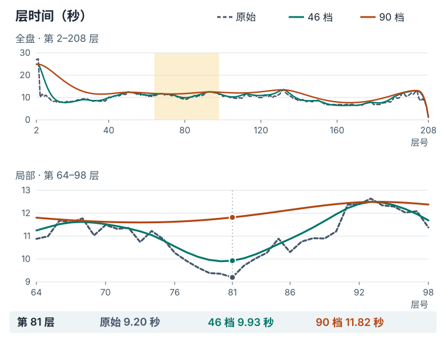
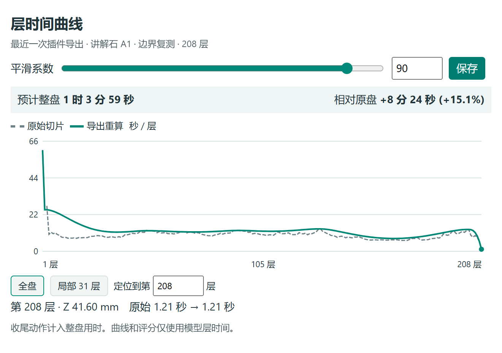
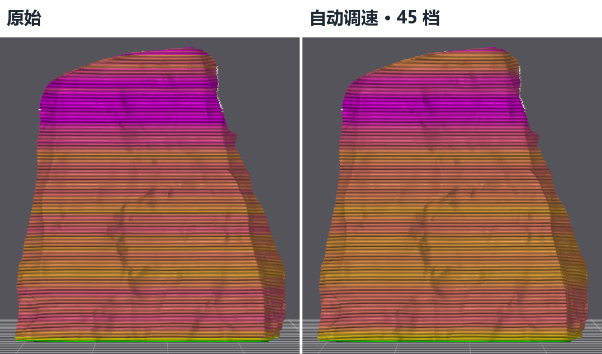
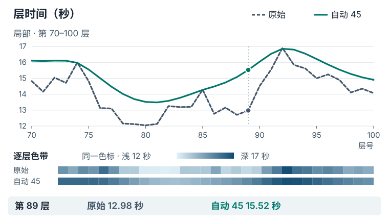
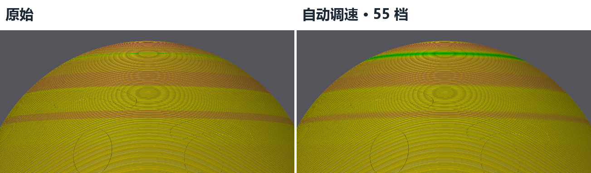
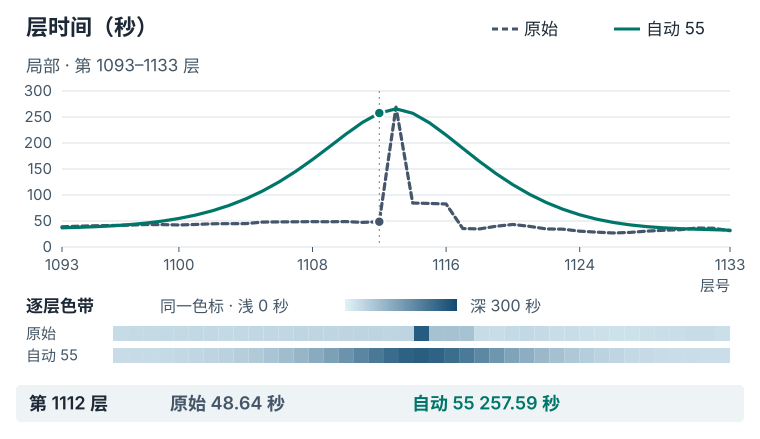
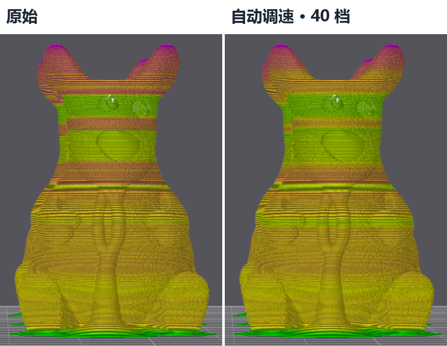
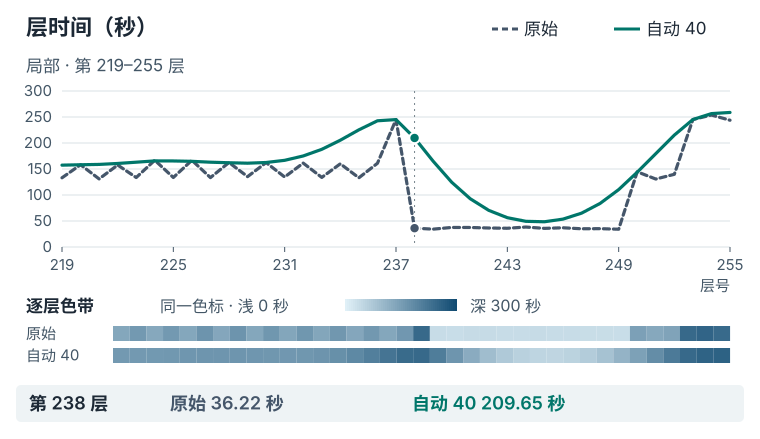

# Layer Time Smoother

**[打开冷却层纹与层时间平滑 Demo](https://alexxpowered.top/layer-time-smoother/)**。可直接试用 Voron Cube，或导入自己的 G-code / 切片 3MF。在 3D 视图右上角点「计算平滑层时间」使用自动选参。面板打开后，同一位置变为「层时间平滑」开关，可来回对比原始和平滑走线、层纹及逐层用时。面板显示整盘预计增减时间，点击「导出平滑 G-code」即可保存结果。

拖动滑块时，逐层用时曲线和整盘时间成本随平滑度更新。开启平滑后，松手会在后台按实际进给复核所选档位，随后更新 3D 并开放导出。首次导入自己的文件需要先分析整盘走线，之后可复用浏览器中保存的曲线输入、各档复核结果和导出文件。文件在浏览器本地处理。导出按钮旁的菜单支持 Bambu Studio 和 OrcaSlicer，直接唤起桌面应用需先运行并配对菜单中提供的本机助手。

通过调整**稀疏填充和内部实心填充的速度**，让相邻打印层的用时平缓过渡，用于研究 FDM 打印的冷却纹。Bambu Studio 版按盘自动选平滑度，OrcaSlicer 插件提供手动滑块。两者共用同一引擎，只调整模型填充的进给速度，保留首层、外墙与内墙、支撑、材料塔、换料和冲刷动作，无需新增暂停。

**[下载安装包](https://github.com/Alexx-Powered/layer-time-smoother/releases/tag/v0.2.2) · [安装与使用](#安装与使用) · [下载离线交互曲线](https://github.com/Alexx-Powered/layer-time-smoother/releases/download/v0.2.2/layer-time-explorer.html)**

## OrcaSlicer 2.5.1 实际导出

原始讲解石 G-code 来自 Windows 版 OrcaSlicer 2.5.1。下表用 0.2.2 插件共用的后处理入口重新生成 46 档和 90 档，并复算导出结果。本次使用 Bambu Lab A1、0.4 mm 喷嘴、Bambu PLA Basic 和 0.20 mm Standard 工艺，共 208 层。下表按导出的运动指令重新估时。整盘以 Orca 文件头的 55 分 35 秒为基准，叠加各层调速带来的时间差。A1 的条件延时摄影、喷头检测按未触发估算。

| 导出工艺 | 预计整盘用时 | 相对原盘 | 第 81 层 | 相邻层时间差 RMS |
|---|---:|---:|---:|---:|
| 原始 | 55 分 35 秒 | — | 9.20 秒 | 1.381 秒 |
| 平滑 46 | 57 分 26 秒 | +3.32% | 9.93 秒 | 0.614 秒 |
| 平滑 90 | 1 小时 3 分 59 秒 | +15.13% | 11.82 秒 | 0.485 秒 |

两档各有 205 层发生调速。逐条对齐三份 G-code，两种处理都只改变了 9,958 条稀疏填充和 24,878 条内部实心填充运动的进给，最高为原值的 150%。两档之间有 197 层的估时差超过 0.01 秒。下图用浅黄色标出第 64–98 层，并在下半图展开。看第 81 层的三个圆点，系数越高，这个低谷被抬得越高。[208 层原始数据](examples/orca-stone-46-90.csv)

[](docs/orca-stone-46-90-time.svg?raw=1)

0.2.2 把收尾动作计入整盘，逐层曲线和评分在模型打印结束处截止。讲解石第 207 层为 **5.94 秒**，第 208 层为 **1.21 秒**。旧图把约 16.41 秒的停车、Z 轴移动和等待并入末层，显示为 17.62 秒。[放大最后 13 层](docs/orca-stone-ending.svg)　下面用新版插件配置页加载本次 90 档数据，读数定位到第 208 层。[46 档配置页](docs/orca-model-only-46.png) · [历史 0.2.0 桌面实测截图](docs/screenshots/orca-plugin-90.png)

[](docs/orca-model-only-90.png?raw=1)

## 三个实际切片

将原始和自动调速后的 G-code 分别导入 Bambu Studio 02.08.02.61，在「预览 → 颜色方案 → 层时间」中放大同一部位并截图。每组左边是原始，右边是自动调速，点击可看原尺寸。模型颜色沿用切片器各自的色标。要按秒比较，请看每组下方的曲线和色带，两份 G-code 共用秒轴和色标，每格代表一层。表中用时按导出指令估算，冷却纹的表面效果仍需实物对照。[带切片器图例的全盘截图](docs/screenshots) · [逐层数据及选参报告](examples)

| 切片 | 层数 | 自动系数 | 层时间转折 RMS，前 → 后 | 整盘预计增时 | 模型末层 |
|---|---:|---:|---:|---:|---:|
| 讲解石 · P2S 单色 | 208 | 45 | 1.61 → 0.20 秒 | 2 分 53 秒（5.63%） | 1.36 秒 |
| H2D · 双喷头，430 次切换 | 1,187 | 55 | 14.96 → 0.74 秒 | 1 小时 15 分 21 秒（10.23%） | 5.28 秒 |
| 肥肥嘟 · P2S 单喷头，三色与异料支撑，89 次换料 | 327 | 40 | 44.01 → 5.91 秒 | 1 小时 22 分 40 秒（16.19%） | 5.98 秒 |

这三份 Bambu Studio 文件都带有明确的收尾起点。用 0.2.2 从原盘重新选参并导出后，三份 G-code 的 SHA-256 均与上次一致，原有切片截图也适用于本次结果。上方的 Orca A1 文件使用另一种结束标记，本次修正改变了它的逐层曲线和导出结果。[五份导出的层数、用时与校验值](examples/boundary-rerun.csv)

### 讲解石 · 单色

看石头下半部的细条带。第 70–100 层中，原盘反复出现短层，45 档把相邻层的用时连成了更平缓的曲线。第 89 层从 **12.98 秒**延长到 **15.52 秒**。

[](docs/stone-model.png?raw=1)

[](docs/stone-layers-time.svg?raw=1)

### H2D · 双喷头

看模型顶部的一圈绿色。原盘的长层集中在很窄的范围内，55 档把过渡分摊到两侧。第 1112 层从 **48.64 秒**延长到 **257.59 秒**，曲线显示它与附近长层如何衔接。

[](docs/h2d-model.png?raw=1)

[](docs/h2d-layers-time.svg?raw=1)

### 肥肥嘟 · 三色与异料支撑

整盘 8 件，左右截取同一件。看两耳之间和颈部交替的色带。固定系数 65 预计多用 47.66%，本盘自动选择了 40。第 238 层从 **36.22 秒**延长到 **209.65 秒**，下图可见相邻层还有多少起伏。[逐层数据](examples/multicolor-layers.csv)

[](docs/multicolor-model.png?raw=1)

[](docs/multicolor-layers-time.svg?raw=1)

## 安装与使用

### Bambu Studio · 自动选参

1. 安装 **Python 3.10 或更新版本**，下载 `layer_smoothing.pyz` 到固定目录。运行只使用 Python 标准库。[下载脚本](https://github.com/Alexx-Powered/layer-time-smoother/releases/download/v0.2.2/layer_smoothing.pyz)
2. 在终端运行 `python -c "import sys; print(sys.executable)"` 找到解释器。macOS / Linux 通常使用 `python3`。
3. 在 Bambu Studio 高级模式的「工艺 → 其他 → 后处理脚本」粘贴下面一行，把两处路径换成本机绝对路径，保留双引号。切片器会自动追加临时 G-code 文件名。

```text
"C:\Path\To\python.exe" "C:\SlicerTools\layer_smoothing.pyz"
```

4. 切片并导出 G-code，重新打开导出文件，选择「层时间」预览。发生调速时，文件内可搜索 `; infill_speed_smoothing policy=auto`，其中 `selected` 是选中系数，`plate_change` 是整盘估时变化。若原样获选，脚本保留原文件。

### OrcaSlicer · 手动滑块

1. 下载 wheel。在 Windows 版 **OrcaSlicer 2.5.1** 左上角，打开「文件」右侧的菜单图标 →「插件」。点右上「安装插件」左侧的小箭头，选择本地安装，选取 `.whl` 并激活。升级时停用旧版本。[下载 0.2.2](https://github.com/Alexx-Powered/layer-time-smoother/releases/download/v0.2.2/orca_layer_smoothing-0.2.2-py3-none-any.whl)
2. 切到工艺的高级视图，打开「其他 → 切片流水线插件 → 添加插件」，选 **Layer Time Smoothing** 并确认。在下方「插件配置 → Configure…」打开层时间曲线。
3. 拖滑块或输入系数（0–100，步长 0.5，默认 65），点「保存」，关闭配置窗口，重新切片并导出。系数 0 让可调填充尽量提到原进给的 150%。系数越高，插件通常会把长短层之间的过渡摊到更多邻层。
4. 首次打开会显示有标记的内置讲解石示例。处理本盘后重新打开配置页，即可看最近一次处理的数据、预计整盘用时和相对变化。0.2.0 的全盘曲线从第 2 层开始，首层保持原速。选择上次使用的系数时显示「导出重算」，拖到其他系数时显示「调速预估」。点击曲线放大附近 31 层，悬停读单层秒数，也可以输入层号定位。

**Windows 2.5.1 权限实测。** 在插件管理器选中本插件，打开「权限」，为这个已核对来源的 wheel 启用「全部权限」，再重新切片。本机用这套配置完成了导出。0.2.0 使用临时文件描述符写回 G-code，Orca 可能弹出目标为空的 Python `open` 权限请求。全部权限是这次验证成功的配置，权限范围比读写当前切片更广。0.2.1 预发布版改用有路径的临时文件，本次桌面导出验证使用 0.2.0。[0.2.1 变更](https://github.com/Alexx-Powered/layer-time-smoother/releases/tag/v0.2.1)

本机另存工艺并重新打开时，还遇到过 Orca 提示「该预设存储的插件功能配置 JSON 无效」，界面回到默认 65。遇到此提示，请在配置页重新输入系数并保存，导出后在 G-code 中搜索 `infill_speed_smoothing policy=manual-` 核对实际数值。

OrcaSlicer 2.3.0 用户可使用 Bambu 版后处理脚本，在命令末尾追加 ` --smoothness 65`。[Orca 插件说明](https://www.orcaslicer.com/wiki/plugins_getting_started/)

### 先用自己的文件试一盘

在脚本所在目录运行下列命令，会生成独立的 G-code 和包含各档评分的 JSON。输入支持带换层、走线类型和运动参数注释的 Bambu/Orca 平面 G-code，以及仅含一盘 G-code 的 `.gcode.3mf`。

```sh
python layer_smoothing.pyz input.gcode --output preview.gcode --audit decision.json
```

查看 `exported.total_s` 和 `exported.change_pct` 可得整盘新估时和相对变化。切片文件头和 `M73` 进度指令保留原切片值。也可以下载页首的离线交互曲线，用浏览器打开，拖动系数或悬停检查三个样本的逐层细节。

## 自动模式怎样取舍

从第 2 层起，同时衡量**相邻层的时间差**和**连续三层的转折**。例如 12、13、14 秒是匀速上坡，转折为零；12、14、12 秒的转折幅度为 4 秒。两项各取均方根（RMS），按原盘归一化并等权计分，再加上整盘耗时增幅。脚本比较原盘与 0–100 间每隔 5 的 21 档候选，选取合格候选中得分最低的一档，写出后重新估时验收。

自动模式把整盘预计用时限制在原盘的 150% 以内。填充指令的进给上限是原值的 150%，遇到极长换料层时，局部填充也可能大幅减速。当前版本按进给倍率限制速度，尚未按材料最大体积流量另行限速。[评分实现](工具/automatic_curve.py)

## 从源码运行

```sh
python -m unittest discover -s 工具 -p "test*.py"
python 工具/slicer_postprocess.py input.gcode --output preview.gcode --audit decision.json
python 工具/compare_layers.py input.gcode preview.gcode layers.csv
```

逐层 CSV 的一行对应一层。讲解石第 2 层的 `z_mm` 为 0.4 毫米，`before_s` 为 25.77543 秒，`after_s` 为 22.59523 秒。[讲解石逐层 CSV](examples/stone-layers.csv)

用 `python 工具/build_layer_explorer.py` 可从公开数据重建交互曲线。重建两个安装包需要 `setuptools>=61` 和 `wheel`，安装后运行 `python 集成/build.py`，产物分别在 `集成/Bambu/` 和 `集成/Orca/`。
